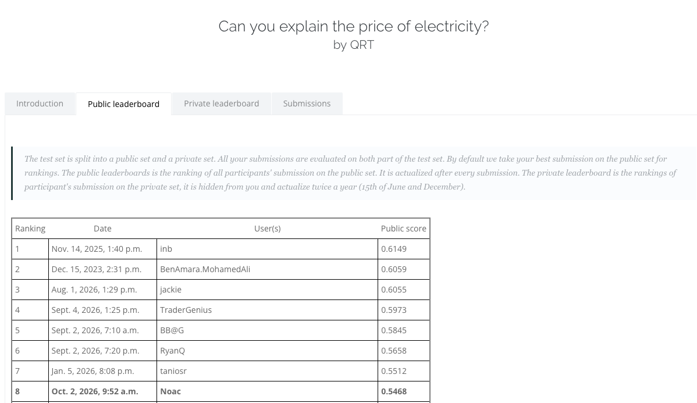

# QRT Electricity Prices

**8th on the public leaderboard · Spearman score: 0.5468**  
Challenge Data · [Qube Research & Technologies Data Challenge "Can you explain the price of electricity ?](https://challengedata.ens.fr/participants/challenges/97/)

*Public leaderboard snapshot: 2 October 2026 · Participant: Noac. Rankings may change.*

## Overview

This project models daily changes in electricity futures prices in France and Germany using weather, energy production, consumption, cross-border flows, and commodity-market data.

The challenge uses Spearman correlation to assess how well predictions rank price changes. It provides 1,494 labelled observations and 654 test observations.

## Approach

- **Data analysis:** examined data quality, relationships between variables, and differences between the two markets.
- **Feature engineering:** developed economically motivated representations of changing market conditions.
- **Modelling:** compared candidate approaches and selected a compact, regularized regression model tailored to each country.
- **Validation:** assessed performance using repeated day-grouped cross-validation and temporal block checks.

The approach emphasizes meaningful data representations and a clear understanding of how the inputs relate to the target.

## Results

| Metric | Score |
| :--- | ---: |
| Public submission | **0.5468** |
| Local validation mean | **0.5505** |

The public result was close to local validation, providing additional evidence of model performance on hidden targets. Local validation also informed model development. These results concern the supplied challenge data, rather than a live trading or forecasting backtest.

## Tools and skills

**Python · NumPy · pandas · SciPy · scikit-learn**

Data analysis, feature engineering, regularized modelling, validation design, and reproducible experimentation.

---

This repository shares a high-level technical overview and leaderboard evidence. Code, data, model artefacts, and implementation details remain private to preserve the competition solution.
